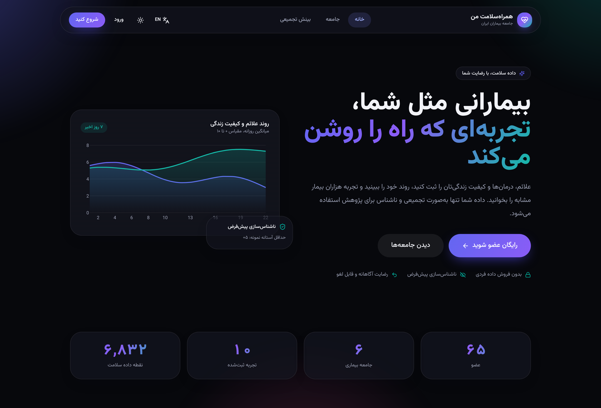
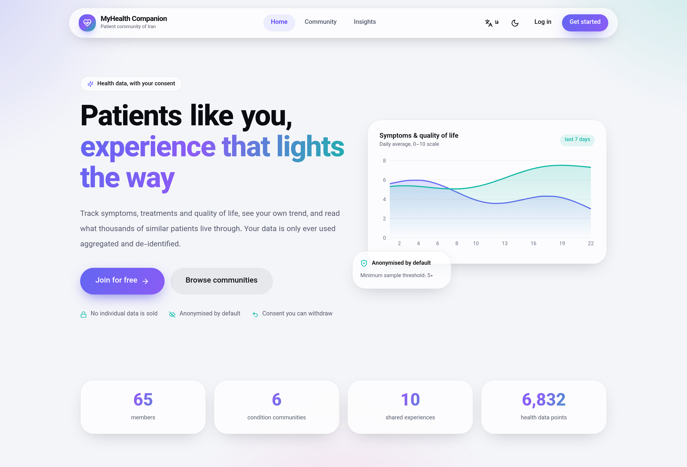
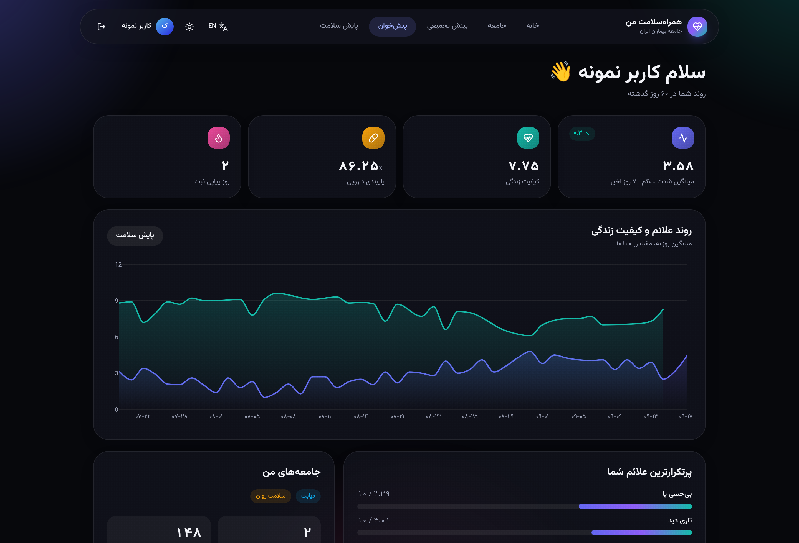
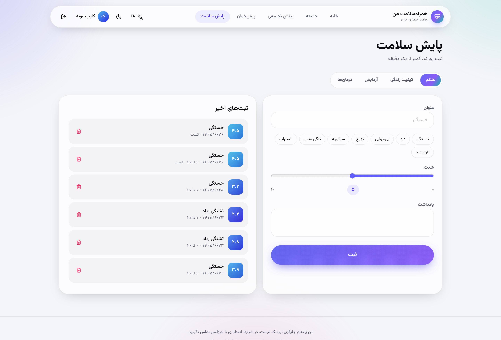
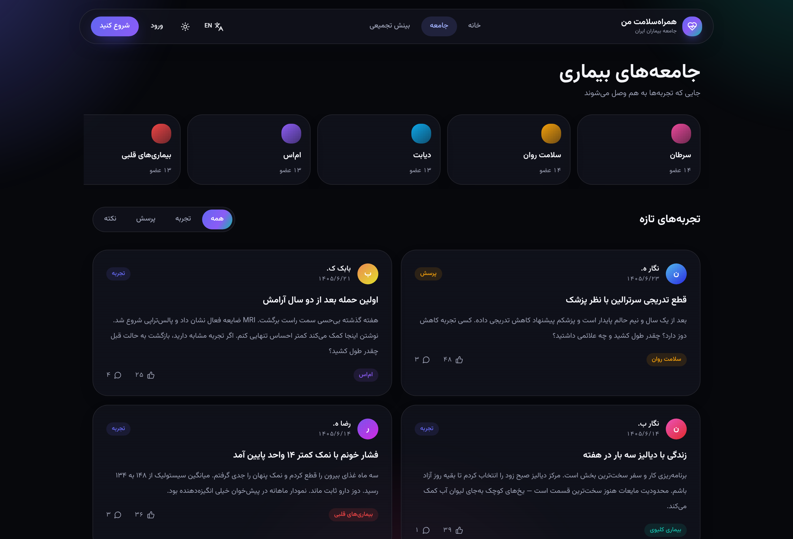
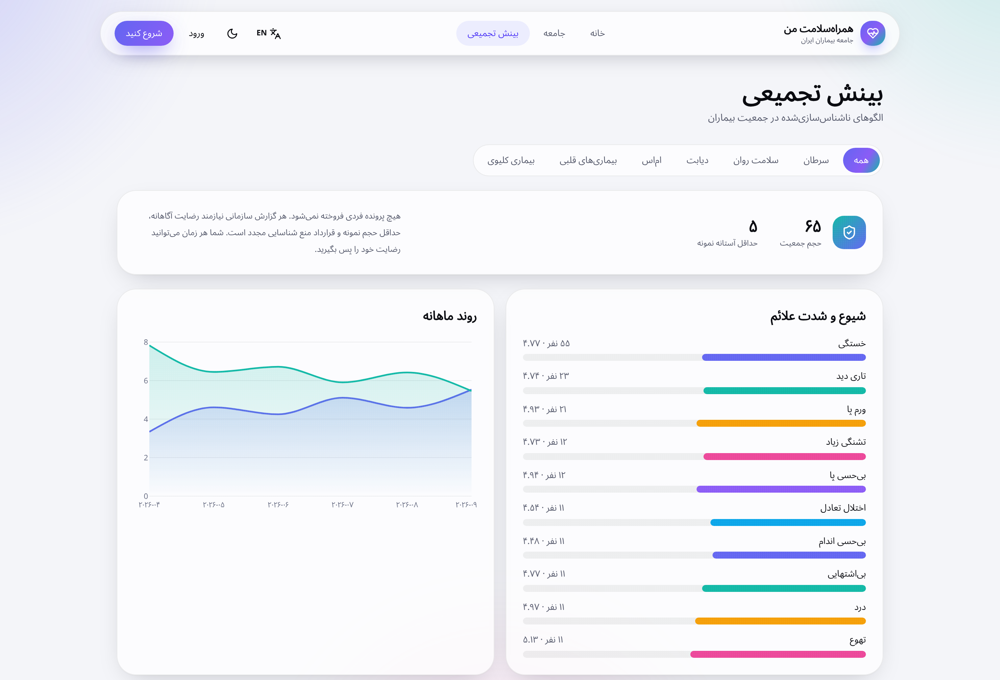

<div dir="rtl">

# همراه‌سلامت من — PatientsLikeMe Iran

پلتفرم جامعه‌محور سلامت دیجیتال برای بیماران مزمن: جامعه بیماری‌محور، پایش طولی سلامت و بینش تجمیعی ناشناس‌سازی‌شده.

</div>

A community health platform for people living with chronic conditions — localised for Iran, fully bilingual (فارسی/English) with RTL/LTR, light/dark, and a responsive, motion-rich UI.

## Screenshots

| | |
|---|---|
|  |  |
| Landing, فارسی / dark | Landing, English / light |
|  |  |
| پیش‌خوان — KPIs & trend | پایش سلامت — daily logging |
|  |  |
| جامعه — feed | بینش تجمیعی — aggregates |

## Stack

| Layer | Tech |
|---|---|
| Frontend | Next.js 15 (App Router), React 19, TypeScript, Tailwind CSS v4, Framer Motion, Recharts, lucide-react |
| Backend | FastAPI, SQLModel, SQLite (volume-backed), JWT (PyJWT), PBKDF2 password hashing |
| Infra | Docker Compose (frontend + backend), Next standalone output |

## Product

Three pillars, straight from the business plan:

1. **جامعه بیماری‌محور / Condition communities** — six seeded communities (diabetes, MS, cancer, cardiovascular, kidney, mental health) with experiences, questions and tips, likes and comments.
2. **پایش سلامت / Personal tracking** — symptoms (0–10), quality of life, lab values and treatments, with trend charts, streaks and KPI deltas on the dashboard.
3. **بینش تجمیعی / Aggregate insights** — symptom prevalence, treatment effectiveness, monthly trend and coarse age buckets. **Never** individual records: every cohort smaller than `MIN_COHORT` (5) is suppressed.

Persian UI copy follows the Persian UX-writing vocabulary reference (پیش‌خوان, حساب کاربری, دیدگاه, رایانامه, همراه‌سازی …).

## Run with Docker (recommended)

```bash
cp .env.example .env      # set SECRET_KEY
docker compose up --build
```

- App: http://localhost:3000
- API docs: http://localhost:8000/docs

## Run locally

```bash
# backend
cd backend
python3 -m venv .venv && .venv/bin/pip install -r requirements.txt
.venv/bin/uvicorn app.main:app --reload --port 8000

# frontend (another shell)
cd frontend
npm install
BACKEND_INTERNAL_URL=http://127.0.0.1:8000 npm run dev
```

The frontend calls `/api/*` on its own origin; `app/api/[...path]/route.ts` proxies to `BACKEND_INTERNAL_URL` **at runtime** (so one image works in any environment). Set `NEXT_PUBLIC_API_URL` instead if you want the browser to hit the API directly.

## Demo account

```
رایانامه: demo@hamrahsalamat.ir
رمز عبور: demo1234
```

The database is seeded on first boot: 6 communities, 65 members, 10 posts with comments, and ~6,800 longitudinal data points — so every chart has real shape from the first second.

## API surface

| Method | Path | Purpose |
|---|---|---|
| POST | `/api/auth/register` · `/api/auth/login` | account + JWT |
| GET/PATCH | `/api/auth/me` | profile & research consent |
| GET | `/api/conditions` · `/api/conditions/{slug}` | communities |
| POST | `/api/conditions/{id}/join` | join / leave |
| GET/POST | `/api/posts` | feed, filterable by condition & kind |
| GET | `/api/posts/{id}` | post + comments |
| POST | `/api/posts/{id}/like` · `/comments` | engagement |
| GET/POST/DELETE | `/api/entries` | longitudinal health records |
| GET/POST/DELETE | `/api/treatments` | treatment list |
| GET | `/api/dashboard` | KPIs, trend, top symptoms, labs |
| GET | `/api/insights` | anonymised aggregates (min cohort 5) |
| GET | `/api/stats` | public counters |

## Design notes

- Aurora gradient system (indigo → violet → teal) over a live blurred backdrop; glass surfaces with `backdrop-filter`.
- Theme and locale are applied before first paint by an inline script — no flash, no hydration mismatch.
- Every layout is fluid; on small screens the nav collapses into a floating bottom tab bar.
- `prefers-reduced-motion` is honoured globally.

## PWA / mobile

Already shipped: `manifest.webmanifest`, maskable icons, and a service worker (`public/sw.js`, cache-first shell + network-first API) registered in production.

Next steps for native packaging:
- **APK / IPA** — wrap with Capacitor (`npx cap add android|ios`) pointing at the deployed URL, or export a static shell and bundle it.
- Push notifications and offline write queue for entries.

## Safety

This platform is not a substitute for medical care, and the UI says so on every page. Content is experience-based, not prescriptive. Aggregate reporting requires informed consent, a minimum sample size and a no-re-identification contract.
